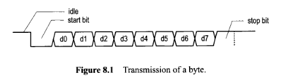

# UART (UNIVERSAL ASYNCHRONOUS RECEIVER/TRANSMITTER)

This repo is about how my journey to learn UART and to build it in fpga ICESUGAR using verilog.

1. learn how UART actually work, we will learn about the protocol thoroughly. 
2. transform this protocol to the real hardware.
3. make the HDL (Hardware Description Language) using verilog for the UART 
4. make the testbench to test the UART that we have build. 
5. implement this code into FPGA, i will use icesugar FPGA, in this step i will configure 
the pin and the clock in this FPGA.

**Disclaimer: this is my first fpga project, so it will be fun!!!**

## UART PROTOCOL
UART is an asynchronous serial protocol thats mean this protocol doesnt send the clock signal 
and rely on internal clock signal of hte transmitter and receiver. Becase of that the 
transmitter and the receiver need to agree on some clock siganl, we called it **baud rate** 
. The baud rate can be variate, nthe common value is 9600 and 115200. For communicating 
UART have 2 lines: Tx (Transmitter) and Rx (Receiver).

UART have some rules to communicate, this rules is determine on how we transmit the data.
If we dont obey this rule the receiver wouldnt understand what data is send and only read 
somne garbage data. This rule also determine on how we design the hardware. Below, i will
discuss all the rule for UART.

As we can see on the picture above, the UART have 8 bit of data and some bit athat have function
to ensure this communication works. The function of each bit:
- **Start bit**: bit that tell the receiver that the communication is start, this bit will toggle
the pin from HIGH (**idle**) to low for 1 clock cycle.
- **data**: data that want to be send, the length of data can be 6,7,8 depends on the settings of UART.
- **stop bit**: the teransmitter will togle back to idle (HIGH) from LOW to tell the receiver that the
communication have finish. The length of this bit can be 1, 1.5, or 2.
- **parity bit** (optional): this bit is optional, the function of this bit is as verification bit.This bit 
will be one when the number of 1 bit in data is odd and 0 when the number is even. 

For this project, i will make UART that have 8 bit data, no parity bit, and 1 stop bit with baud rate of 9600 bauds.
For transmitting data, the LSB bit will be transferred first. For example you want to sent letter A using ASCII symbol 
01000001, so the transmition will be:

0 (start bit) | 1 0 0 0 0 0 1 0 (data bit, from LSB to MSB)| 1 (stop bit)

Then i want to talk about how the UART is being transmited and received. So the communication will rely on
counter instead of just using the clock. This is to ensure that data is will received correctly although clock
in the transmitter and receiver is different, because in real world no way that two device have exact clock baud 
rate. This method will use middle number of the counter. THe counter will count until from 0 to 15 and when have counted until
7 it will get the data and then reset when the counter hit 15. For example:
1. Receiver will see the pin is pull low, this is startign point of communication so the receiver will start
the counter until 7 then restart the counter to 0, then will count again.
2. When hit 15 it will reach the middle of the transmit bit then will shift hte bit to register inside the receiver
3. It will be repeated until the end of data bit then iwll start to count for the stop bit.

Because the lwength of the data and stop bit can be variate so the transmitter and receiver must have same configuration before
communicating. We use the standard config (8 data 1 stop bit). Actually the uart system can be included more blocks for interract
with the main processor. One of the function of this blocks is to tell the main processo that there is a new data received. This
block is called interface.

Now is for the transmitter system. The system of the transmitter   

## HARDWARE
There will be two counter, one is for count the sampler and the other is to count the data. For 8-N-1 design, value of 
sampler for start and stop bit is 8 and 16. The baud rate of transmitter is 16x slower than the receiver to acomodate 
the sampler method in receiver.

